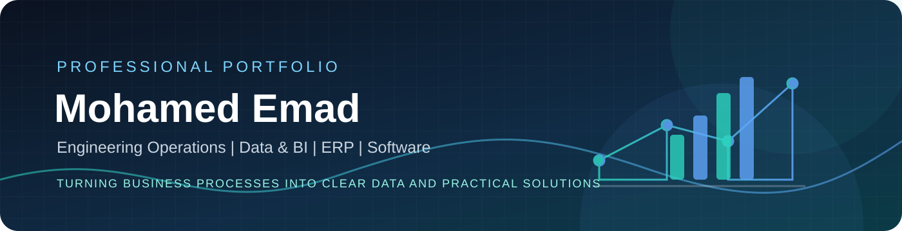
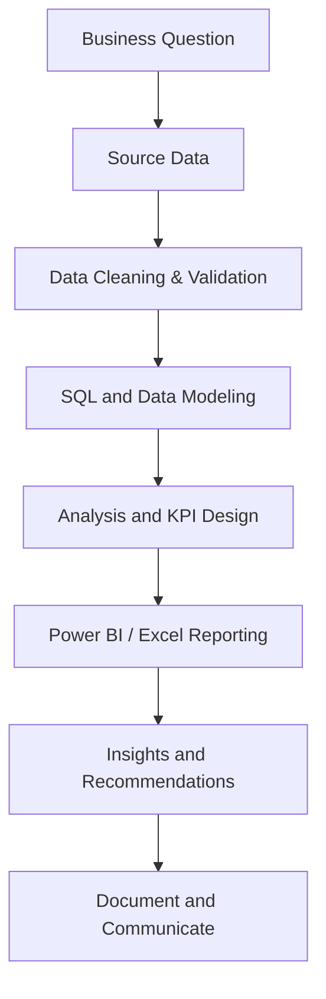

<!-- Profile README for EMAD7461 -->

  
   
  <a href="https://www.linkedin.com/in/mohmedemad/">LinkedIn</a> &nbsp;•&nbsp;
  <a href="https://github.com/EMAD7461">GitHub</a> &nbsp;•&nbsp;
  <a href="mailto:emad7461@gmail.com">Email</a>

<table>
  <tr>
    <td width="31%" valign="top">
      <h2>Profile Snapshot</h2>
      
<strong>Location</strong> Egypt

      
<strong>Background</strong> Civil Engineering FTTH &amp; Fiber-Optic Projects

      
<strong>Experience</strong> 5+ years in engineering and project operations

      
<strong>Professional Focus</strong>

      <ul>
        <li>Procurement &amp; SCM</li>
        <li>Project Operations</li>
        <li>Data Analytics &amp; BI</li>
        <li>ERP &amp; Business Systems</li>
        <li>.NET Development</li>
      </ul>
      
<strong>Core Tools</strong> Power BI · SQL Server · Excel · C# · .NET · Python · Odoo · ERPNext · AutoCAD

      
<strong>Education</strong> B.Sc. Civil Engineering AL-SaLaM Higher Institute for Engineering &amp; Technology

      
<strong>Languages</strong> Arabic · English (B2)

      
<strong>Connect</strong> <a href="https://www.linkedin.com/in/mohmedemad/">LinkedIn profile</a> <a href="mailto:emad7461@gmail.com">Email Mohamed</a>

    </td>
    <td width="69%" valign="top">
      <h2>About Me</h2>
      
I am a Civil Engineer with more than five years of experience in fiber-optic and FTTH project environments. My background in technical-office work gives me an operational understanding of quantities, documentation, invoices, site coordination, and project delivery.

      
I combine this engineering experience with hands-on projects in data analytics, business intelligence, and software development. I am particularly interested in connecting procurement and supply-chain processes with ERP systems, reliable data, and clear performance reporting.

      <h3>What I Bring</h3>
      <ul>
        <li><strong>Engineering operations:</strong> civil quantities, FTTH/fiber-optic activities, as-built records, technical documentation, and invoice workflows.</li>
        <li><strong>Procurement &amp; SCM:</strong> purchasing workflows, supplier and PO processes, material planning concepts, inventory, and procurement reporting.</li>
        <li><strong>Data &amp; BI:</strong> data cleaning, validation, relational modeling, SQL, DAX, Power Query, Excel, and Power BI dashboards.</li>
        <li><strong>ERP &amp; digital systems:</strong> Odoo, ERPNext, and Oracle Fusion SCM learning across procurement, inventory, and business operations.</li>
        <li><strong>Software:</strong> C#, .NET, ASP.NET Core, Entity Framework, LINQ, and Python-based projects.</li>
      </ul>
      
<strong>My approach:</strong> understand the process first, structure the data, validate assumptions, and then build a solution that people can use.

    </td>
  </tr>
</table>

---

## Featured Portfolio

### Credentials Dashboard

An interactive collection of 69 certificates, badges, and program records, organized across eight learning areas. The dashboard includes search, topic filters, collection insights, and direct links to each source document.

[**Browse the certificate collection →**](https://github.com/EMAD7461/EMAD7461/tree/main/certificates) · [View the dashboard source](https://github.com/EMAD7461/EMAD7461/blob/main/certificates/index.html)
### 1. Olist E-Commerce Analytics
**SQL Server · Python · Power Query · Excel · Power BI**

An end-to-end analytics project based on the Brazilian E-Commerce Public Dataset by Olist. The repository includes source data, a Python cleaning and EDA notebook, SQL analysis, an ERD, Excel dashboards, a Power BI report, and final documentation in English and Arabic.

  <strong>Selected analysis visuals</strong> 
  
  

  
  

**Key project work**
- Data preparation and quality checks across customers, orders, products, sellers, payments, reviews, and geolocation.
- SQL-based business questions and relational analysis.
- ERD and data-model documentation.
- Financial reconciliation checks and investigation of differences.
- Reporting deliverables in Excel and Power BI.

  
<strong>Explore Olist deliverables</strong>

  - [Python cleaning and EDA notebook](https://github.com/EMAD7461/Olist-E-Commerce-Analytics/tree/main/2.%20Python%20notebook%20%28.ipynb%29%20containing%20data%20cleaning%20and%20EDA)
  - [SQL Server scripts](https://github.com/EMAD7461/Olist-E-Commerce-Analytics/tree/main/3.%20SQL%20file%20%28.sql%29%20containing%20database%20design%20and%20analytical%20queries)
  - [ERD and relational schema](https://github.com/EMAD7461/Olist-E-Commerce-Analytics/tree/main/4.%20ERD%20and%20relational%20schema)
  - [Excel dashboard workbook](https://github.com/EMAD7461/Olist-E-Commerce-Analytics/tree/main/5.%20Excel%20workbook%20%28.xlsx%29%20containing%20two%20interactive%20dashboards)
  - [Power BI report](https://github.com/EMAD7461/Olist-E-Commerce-Analytics/tree/main/6.%20Power%20BI%20report%20%28.pbix%29%20containing%20two%20interactive%20dashboards)
  - [English final report](https://github.com/EMAD7461/Olist-E-Commerce-Analytics/blob/main/7.%20PDF%20report%20summarizing%20insights%20and%20recommendations/Olist_Final_Project.pdf)
  - [Arabic final report](https://github.com/EMAD7461/Olist-E-Commerce-Analytics/blob/main/7.%20PDF%20report%20summarizing%20insights%20and%20recommendations/Olist_Final_Project_Report_AR.pdf)
  - [Project presentation](https://github.com/EMAD7461/Olist-E-Commerce-Analytics/tree/main/8.%20PowerPoint%20presentation%20%28.pptx%29%20covering%20the%20complete%20project)

[**Open Olist repository →**](https://github.com/EMAD7461/Olist-E-Commerce-Analytics)

### 2. Carrefour Sales Analytics
**Power BI · DAX · Power Query · PBIP**

A multi-page Power BI project with an editable PBIP report, semantic model, native visuals, slicers, theme assets, source CSV files, and a PBIX copy.

- Home and Sales Overview
- Product & Category Analysis
- Customer Analysis
- Regional & Profitability Analysis

  
<strong>Technical notes and how to run it</strong>

  The current semantic model points to local CSV file paths from the development environment. After cloning, update the Power Query `File.Contents` paths for all eight source tables, apply changes, and refresh. The profitability view is an estimate based on matched product unit costs, not company net profit.

  This is an independent portfolio project and is not presented as commissioned by or endorsed by Carrefour.

[**Open Carrefour repository →**](https://github.com/EMAD7461/Carrefour_Sales_Analytics_4Page)

### 3. Hospital Management System
**C# · ASP.NET Core · .NET 8 · Entity Framework Core · SQL Server**

A team graduation project from the Digital Egypt Pioneers Initiative (DEPI), .NET Web Developer track. The repository includes the web application structure, database assets, ERD, documentation, and presentation.

  

[**Open Hospital Management repository →**](https://github.com/EMAD7461/Hospital-Managment-System)

### 4. Flight Reservation Application
**Python · Tkinter · SQLite**

A desktop application for creating and managing flight reservations, with booking, viewing, editing, and deleting workflows backed by a local SQLite database.

[**Open Flight Reservation repository →**](https://github.com/EMAD7461/flight-reservation-app)

### 5. Heart Disease Machine Learning Pipeline
**Python · Pandas · Scikit-learn · PCA · Streamlit**

A machine-learning project documenting preprocessing, feature selection, PCA, supervised and unsupervised models, hyperparameter tuning, model export, and an optional Streamlit interface.

[**Open Heart Disease ML repository →**](https://github.com/EMAD7461/HeartDiseaseML)

---

## Work Experience & Professional Development

  
<strong>Discover20 — Data Analyst | ALX Data Analyst Internship</strong>

  Worked with survey data collected through Google Forms, using Power Query and Excel for data cleaning, transformation, and standardization. Built a Power BI dashboard to communicate user preferences and product insights, including multi-choice response analysis and an Arabic RTL dashboard design.

  
<strong>FTTH / Fiber-Optic Engineering & Technical Office</strong>

  More than five years of experience in fiber-optic project environments, including civil-work quantities, microduct and cable activities, ODF/cabinet and manhole documentation, as-built records, measurement sheets, invoice attachments, and coordination between project stakeholders.

  
<strong>Selected Credentials</strong>

  - **Generative AI Overview for Project Managers** — Project Management Institute (PMI), Dec 2024.
  - **AI for Beginners** — HP LIFE, Dec 2024.
  - **Team Leader Recognition** — Digital Egypt Pioneers Initiative (DEPI), Apr 2024.
  - **Design Thinking** — HP LIFE, Apr 2023.
  - **Presenting Data** — HP LIFE, Apr 2023.
  - **The Digital Marketing Challenger Track** — MCIT Egypt, Jan 2023.

  See the [LinkedIn profile](https://www.linkedin.com/in/mohmedemad/) for credential details and verification links.

---

## How I Approach Data & Business Projects

The workflow below represents how I structure analytical and digital projects, illustrated by the Olist work.

## Technology Stack

**Analytics & Reporting**

**Data & Software Development**

**Business Systems & Engineering Tools**

---

## GitHub Activity

  
   
  

**Open to collaboration on engineering operations, procurement, ERP, analytics, and software projects.**

[LinkedIn](https://www.linkedin.com/in/mohmedemad/) · [GitHub](https://github.com/EMAD7461) · [Email](mailto:emad7461@gmail.com)

Skills reflect a combination of professional experience, published project work, and ongoing learning. Project READMEs describe scope, assumptions, requirements, and limitations.
