

  
  <h1>Certificates &amp; Professional Learning</h1>
  
<strong>69 credentials</strong> &nbsp;·&nbsp; <strong>8 learning areas</strong> &nbsp;·&nbsp; <strong>55 document previews</strong>

  
PDF certificates are displayed as image previews. Click a preview to view it full size, or use its separate link to open the original PDF.

  
<a href="https://github.com/EMAD7461/EMAD7461#readme">← Back to GitHub profile</a> &nbsp;·&nbsp; <a href="https://github.com/EMAD7461/EMAD7461/tree/main/certificates">Browse certificate folders</a>

---

## Explore by area

[Data Analytics and Business Intelligence (29)](#data-analytics-and-business-intelligence) · [Artificial Intelligence and Machine Learning (11)](#artificial-intelligence-and-machine-learning) · [Business and Career Development (9)](#business-and-career-development) · [Cloud and Digital Foundations (3)](#cloud-and-digital-foundations) · [Cybersecurity and AI Governance (11)](#cybersecurity-and-ai-governance) · [Product Design and Marketing (3)](#product-design-and-marketing) · [Software Development (2)](#software-development) · [Additional Credentials (1)](#additional-credentials)

---

## Data Analytics and Business Intelligence

<table><tbody>
  <tr>
    <td width="50%" align="center" valign="top">
      <a href="https://github.com/EMAD7461/EMAD7461/blob/main/certificates/data-analytics/discover20-data-analysis-internship.png">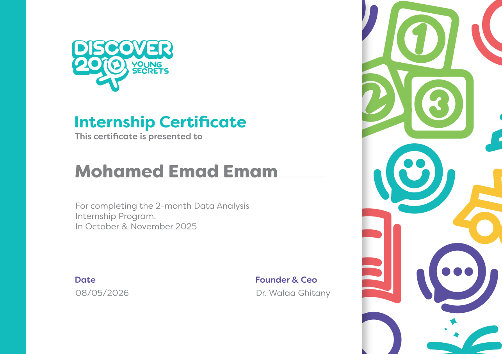</a> 
      <strong>Discover20 Data Analysis Internship</strong> 
      Discover20 · 2026 
      <a href="https://github.com/EMAD7461/EMAD7461/blob/main/certificates/data-analytics/discover20-data-analysis-internship.png">Open original PNG ↗</a>
    </td>
    <td width="50%" align="center" valign="top">
       
      <strong>Analyze Data to Answer Questions</strong> 
      Google / Coursera · 2026 
      <a href="https://raw.githubusercontent.com/EMAD7461/EMAD7461/main/certificates/previews/data-analytics/analyze-data-to-answer-questions.jpg">View image preview ↗</a> · <a href="https://github.com/EMAD7461/EMAD7461/blob/main/certificates/data-analytics/analyze-data-to-answer-questions.pdf">Open original PDF ↗</a>
    </td>
  </tr>
  <tr>
    <td width="50%" align="center" valign="top">
       
      <strong>Prepare Data for Exploration</strong> 
      Google / Coursera · 2026 
      <a href="https://raw.githubusercontent.com/EMAD7461/EMAD7461/main/certificates/previews/data-analytics/prepare-data-for-exploration.jpg">View image preview ↗</a> · <a href="https://github.com/EMAD7461/EMAD7461/blob/main/certificates/data-analytics/prepare-data-for-exploration.pdf">Open original PDF ↗</a>
    </td>
    <td width="50%" align="center" valign="top">
       
      <strong>Introduction to Data Analysis Using Python</strong> 
      Google / Coursera · 2026 
      <a href="https://raw.githubusercontent.com/EMAD7461/EMAD7461/main/certificates/previews/data-analytics/introduction-to-data-analysis-using-python.jpg">View image preview ↗</a> · <a href="https://github.com/EMAD7461/EMAD7461/blob/main/certificates/data-analytics/introduction-to-data-analysis-using-python.pdf">Open original PDF ↗</a>
    </td>
  </tr>
  <tr>
    <td width="50%" align="center" valign="top">
      <a href="https://raw.githubusercontent.com/EMAD7461/EMAD7461/main/certificates/previews/data-analytics/google-data-analytics-professional-certificate.jpg">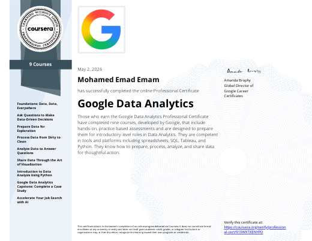</a> 
      <strong>Google Data Analytics Professional Certificate</strong> 
      Google / Coursera · 2026 
      <a href="https://raw.githubusercontent.com/EMAD7461/EMAD7461/main/certificates/previews/data-analytics/google-data-analytics-professional-certificate.jpg">View image preview ↗</a> · <a href="https://github.com/EMAD7461/EMAD7461/blob/main/certificates/data-analytics/google-data-analytics-professional-certificate.pdf">Open original PDF ↗</a>
    </td>
    <td width="50%" align="center" valign="top">
      <a href="https://raw.githubusercontent.com/EMAD7461/EMAD7461/main/certificates/previews/data-analytics/share-data-through-the-art-of-visualization.jpg">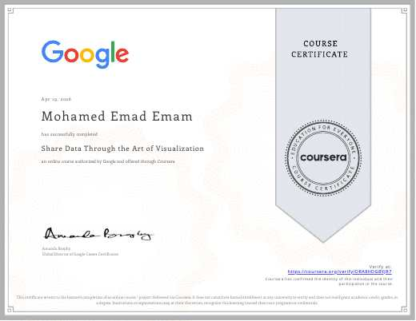</a> 
      <strong>Share Data Through the Art of Visualization</strong> 
      Google / Coursera · 2026 
      <a href="https://raw.githubusercontent.com/EMAD7461/EMAD7461/main/certificates/previews/data-analytics/share-data-through-the-art-of-visualization.jpg">View image preview ↗</a> · <a href="https://github.com/EMAD7461/EMAD7461/blob/main/certificates/data-analytics/share-data-through-the-art-of-visualization.pdf">Open original PDF ↗</a>
    </td>
  </tr>
  <tr>
    <td width="50%" align="center" valign="top">
      <a href="https://raw.githubusercontent.com/EMAD7461/EMAD7461/main/certificates/previews/data-analytics/process-data-from-dirty-to-clean.jpg">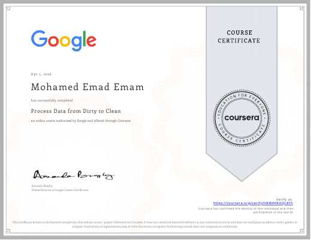</a> 
      <strong>Process Data from Dirty to Clean</strong> 
      Google / Coursera · 2026 
      <a href="https://raw.githubusercontent.com/EMAD7461/EMAD7461/main/certificates/previews/data-analytics/process-data-from-dirty-to-clean.jpg">View image preview ↗</a> · <a href="https://github.com/EMAD7461/EMAD7461/blob/main/certificates/data-analytics/process-data-from-dirty-to-clean.pdf">Open original PDF ↗</a>
    </td>
    <td width="50%" align="center" valign="top">
       
      <strong>Foundations: Data, Data, Everywhere</strong> 
      Google / Coursera · 2026 
      <a href="https://raw.githubusercontent.com/EMAD7461/EMAD7461/main/certificates/previews/data-analytics/foundations-data-data-everywhere.jpg">View image preview ↗</a> · <a href="https://github.com/EMAD7461/EMAD7461/blob/main/certificates/data-analytics/foundations-data-data-everywhere.pdf">Open original PDF ↗</a>
    </td>
  </tr>
  <tr>
    <td width="50%" align="center" valign="top">
      <a href="https://raw.githubusercontent.com/EMAD7461/EMAD7461/main/certificates/previews/data-analytics/ask-questions-to-make-data-driven-decisions.jpg">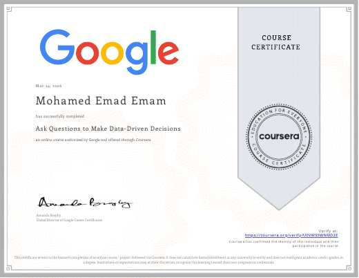</a> 
      <strong>Ask Questions to Make Data-Driven Decisions</strong> 
      Google / Coursera · 2026 
      <a href="https://raw.githubusercontent.com/EMAD7461/EMAD7461/main/certificates/previews/data-analytics/ask-questions-to-make-data-driven-decisions.jpg">View image preview ↗</a> · <a href="https://github.com/EMAD7461/EMAD7461/blob/main/certificates/data-analytics/ask-questions-to-make-data-driven-decisions.pdf">Open original PDF ↗</a>
    </td>
    <td width="50%" align="center" valign="top">
      <a href="https://raw.githubusercontent.com/EMAD7461/EMAD7461/main/certificates/previews/data-analytics/data-analysis-internship.jpg">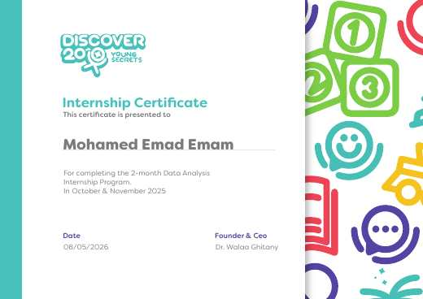</a> 
      <strong>Data Analysis Internship</strong> 
      Discover20 · 2026 
      <a href="https://raw.githubusercontent.com/EMAD7461/EMAD7461/main/certificates/previews/data-analytics/data-analysis-internship.jpg">View image preview ↗</a> · <a href="https://github.com/EMAD7461/EMAD7461/blob/main/certificates/data-analytics/data-analysis-internship.pdf">Open original PDF ↗</a>
    </td>
  </tr>
  <tr>
    <td width="50%" align="center" valign="top">
      <a href="https://github.com/EMAD7461/EMAD7461/blob/main/certificates/data-analytics/introduction-to-excel.png">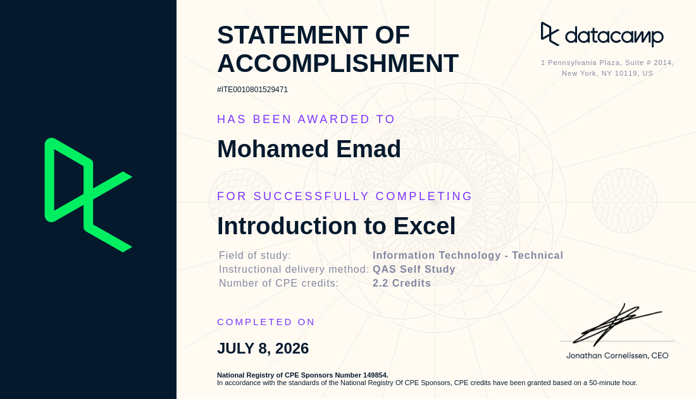</a> 
      <strong>Introduction to Excel</strong> 
      DataCamp · 2026 
      <a href="https://github.com/EMAD7461/EMAD7461/blob/main/certificates/data-analytics/introduction-to-excel.png">Open original PNG ↗</a>
    </td>
    <td width="50%" align="center" valign="top">
      <a href="https://raw.githubusercontent.com/EMAD7461/EMAD7461/main/certificates/previews/data-analytics/ai-excellence-innovation-sprint-data-analysis-track.jpg">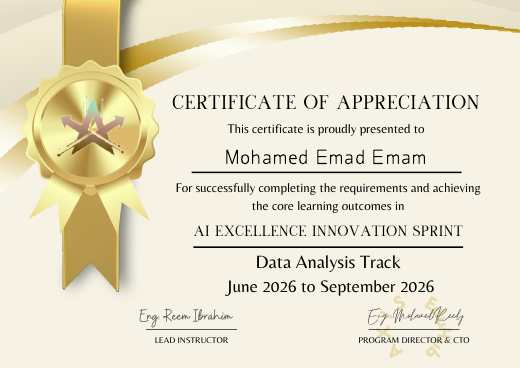</a> 
      <strong>AI Excellence Innovation Sprint — Data Analysis Track</strong> 
      Axis EduHub · 2026 
      <a href="https://raw.githubusercontent.com/EMAD7461/EMAD7461/main/certificates/previews/data-analytics/ai-excellence-innovation-sprint-data-analysis-track.jpg">View image preview ↗</a> · <a href="https://github.com/EMAD7461/EMAD7461/blob/main/certificates/data-analytics/ai-excellence-innovation-sprint-data-analysis-track.pdf">Open original PDF ↗</a>
    </td>
  </tr>
  <tr>
    <td width="50%" align="center" valign="top">
      <a href="https://raw.githubusercontent.com/EMAD7461/EMAD7461/main/certificates/previews/data-analytics/advanced-excel-functions.jpg">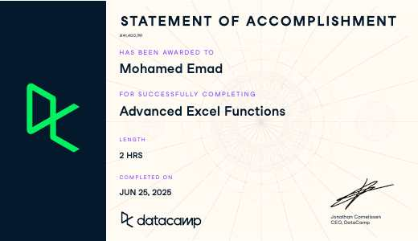</a> 
      <strong>Advanced Excel Functions</strong> 
      DataCamp · 2025 
      <a href="https://raw.githubusercontent.com/EMAD7461/EMAD7461/main/certificates/previews/data-analytics/advanced-excel-functions.jpg">View image preview ↗</a> · <a href="https://github.com/EMAD7461/EMAD7461/blob/main/certificates/data-analytics/advanced-excel-functions.pdf">Open original PDF ↗</a>
    </td>
    <td width="50%" align="center" valign="top">
       
      <strong>Data Analysis with Excel Power Tools</strong> 
      DataCamp · 2025 
      <a href="https://raw.githubusercontent.com/EMAD7461/EMAD7461/main/certificates/previews/data-analytics/data-analysis-with-excel-power-tools.jpg">View image preview ↗</a> · <a href="https://github.com/EMAD7461/EMAD7461/blob/main/certificates/data-analytics/data-analysis-with-excel-power-tools.pdf">Open original PDF ↗</a>
    </td>
  </tr>
  <tr>
    <td width="50%" align="center" valign="top">
       
      <strong>Data Preparation in Excel</strong> 
      DataCamp · 2025 
      <a href="https://raw.githubusercontent.com/EMAD7461/EMAD7461/main/certificates/previews/data-analytics/data-preparation-in-excel.jpg">View image preview ↗</a> · <a href="https://github.com/EMAD7461/EMAD7461/blob/main/certificates/data-analytics/data-preparation-in-excel.pdf">Open original PDF ↗</a>
    </td>
    <td width="50%" align="center" valign="top">
       
      <strong>Data Visualization in Excel</strong> 
      DataCamp · 2025 
      <a href="https://raw.githubusercontent.com/EMAD7461/EMAD7461/main/certificates/previews/data-analytics/data-visualization-in-excel.jpg">View image preview ↗</a> · <a href="https://github.com/EMAD7461/EMAD7461/blob/main/certificates/data-analytics/data-visualization-in-excel.pdf">Open original PDF ↗</a>
    </td>
  </tr>
  <tr>
    <td width="50%" align="center" valign="top">
      <a href="https://raw.githubusercontent.com/EMAD7461/EMAD7461/main/certificates/previews/data-analytics/intermediate-power-query-in-excel.jpg">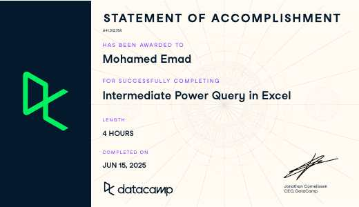</a> 
      <strong>Intermediate Power Query in Excel</strong> 
      DataCamp · 2025 
      <a href="https://raw.githubusercontent.com/EMAD7461/EMAD7461/main/certificates/previews/data-analytics/intermediate-power-query-in-excel.jpg">View image preview ↗</a> · <a href="https://github.com/EMAD7461/EMAD7461/blob/main/certificates/data-analytics/intermediate-power-query-in-excel.pdf">Open original PDF ↗</a>
    </td>
    <td width="50%" align="center" valign="top">
       
      <strong>Intermediate SQL</strong> 
      DataCamp · 2025 
      <a href="https://raw.githubusercontent.com/EMAD7461/EMAD7461/main/certificates/previews/data-analytics/intermediate-sql.jpg">View image preview ↗</a> · <a href="https://github.com/EMAD7461/EMAD7461/blob/main/certificates/data-analytics/intermediate-sql.pdf">Open original PDF ↗</a>
    </td>
  </tr>
  <tr>
    <td width="50%" align="center" valign="top">
      <a href="https://raw.githubusercontent.com/EMAD7461/EMAD7461/main/certificates/previews/data-analytics/introduction-to-data.jpg">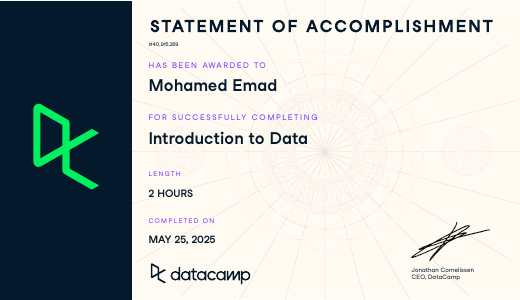</a> 
      <strong>Introduction to Data</strong> 
      DataCamp · 2025 
      <a href="https://raw.githubusercontent.com/EMAD7461/EMAD7461/main/certificates/previews/data-analytics/introduction-to-data.jpg">View image preview ↗</a> · <a href="https://github.com/EMAD7461/EMAD7461/blob/main/certificates/data-analytics/introduction-to-data.pdf">Open original PDF ↗</a>
    </td>
    <td width="50%" align="center" valign="top">
       
      <strong>Introduction to Power BI</strong> 
      DataCamp · 2025 
      <a href="https://raw.githubusercontent.com/EMAD7461/EMAD7461/main/certificates/previews/data-analytics/introduction-to-power-bi.jpg">View image preview ↗</a> · <a href="https://github.com/EMAD7461/EMAD7461/blob/main/certificates/data-analytics/introduction-to-power-bi.pdf">Open original PDF ↗</a>
    </td>
  </tr>
  <tr>
    <td width="50%" align="center" valign="top">
      <a href="https://raw.githubusercontent.com/EMAD7461/EMAD7461/main/certificates/previews/data-analytics/introduction-to-sql.jpg">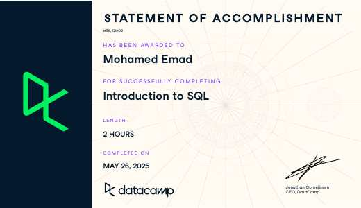</a> 
      <strong>Introduction to SQL</strong> 
      DataCamp · 2025 
      <a href="https://raw.githubusercontent.com/EMAD7461/EMAD7461/main/certificates/previews/data-analytics/introduction-to-sql.jpg">View image preview ↗</a> · <a href="https://github.com/EMAD7461/EMAD7461/blob/main/certificates/data-analytics/introduction-to-sql.pdf">Open original PDF ↗</a>
    </td>
    <td width="50%" align="center" valign="top">
      <a href="https://raw.githubusercontent.com/EMAD7461/EMAD7461/main/certificates/previews/data-analytics/power-pivot-in-excel.jpg">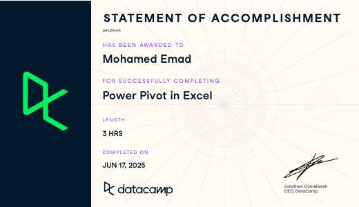</a> 
      <strong>Power Pivot in Excel</strong> 
      DataCamp · 2025 
      <a href="https://raw.githubusercontent.com/EMAD7461/EMAD7461/main/certificates/previews/data-analytics/power-pivot-in-excel.jpg">View image preview ↗</a> · <a href="https://github.com/EMAD7461/EMAD7461/blob/main/certificates/data-analytics/power-pivot-in-excel.pdf">Open original PDF ↗</a>
    </td>
  </tr>
  <tr>
    <td width="50%" align="center" valign="top">
      <a href="https://raw.githubusercontent.com/EMAD7461/EMAD7461/main/certificates/previews/data-analytics/clean-refine-and-visualize-data.jpg">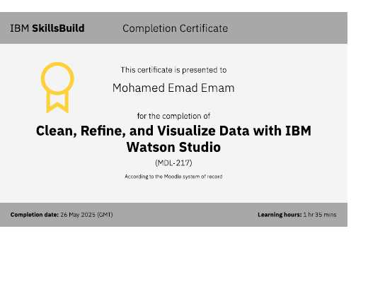</a> 
      <strong>Clean, Refine, and Visualize Data</strong> 
      IBM SkillsBuild · Year not listed 
      <a href="https://raw.githubusercontent.com/EMAD7461/EMAD7461/main/certificates/previews/data-analytics/clean-refine-and-visualize-data.jpg">View image preview ↗</a> · <a href="https://github.com/EMAD7461/EMAD7461/blob/main/certificates/data-analytics/clean-refine-and-visualize-data.pdf">Open original PDF ↗</a>
    </td>
    <td width="50%" align="center" valign="top">
       
      <strong>Data Science in Our World</strong> 
      IBM SkillsBuild · Year not listed 
      <a href="https://raw.githubusercontent.com/EMAD7461/EMAD7461/main/certificates/previews/data-analytics/data-science-in-our-world.jpg">View image preview ↗</a> · <a href="https://github.com/EMAD7461/EMAD7461/blob/main/certificates/data-analytics/data-science-in-our-world.pdf">Open original PDF ↗</a>
    </td>
  </tr>
  <tr>
    <td width="50%" align="center" valign="top">
      <a href="https://raw.githubusercontent.com/EMAD7461/EMAD7461/main/certificates/previews/data-analytics/data-fundamentals.jpg">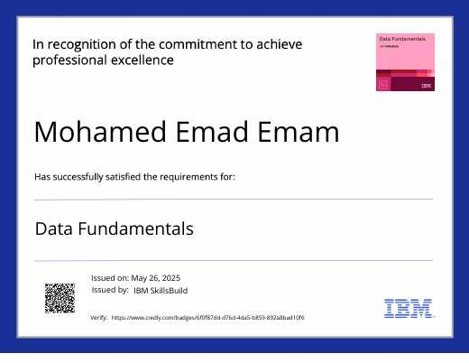</a> 
      <strong>Data Fundamentals</strong> 
      IBM SkillsBuild · 2025 
      <a href="https://raw.githubusercontent.com/EMAD7461/EMAD7461/main/certificates/previews/data-analytics/data-fundamentals.jpg">View image preview ↗</a> · <a href="https://github.com/EMAD7461/EMAD7461/blob/main/certificates/data-analytics/data-fundamentals.pdf">Open original PDF ↗</a>
    </td>
    <td width="50%" align="center" valign="top">
      <a href="https://raw.githubusercontent.com/EMAD7461/EMAD7461/main/certificates/previews/data-analytics/introduction-to-data-concepts.jpg">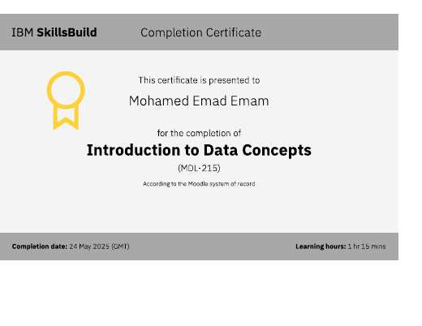</a> 
      <strong>Introduction To Data Concepts</strong> 
      IBM SkillsBuild · Year not listed 
      <a href="https://raw.githubusercontent.com/EMAD7461/EMAD7461/main/certificates/previews/data-analytics/introduction-to-data-concepts.jpg">View image preview ↗</a> · <a href="https://github.com/EMAD7461/EMAD7461/blob/main/certificates/data-analytics/introduction-to-data-concepts.pdf">Open original PDF ↗</a>
    </td>
  </tr>
  <tr>
    <td width="50%" align="center" valign="top">
      <a href="https://raw.githubusercontent.com/EMAD7461/EMAD7461/main/certificates/previews/data-analytics/overview-of-data-tools-and-languages.jpg">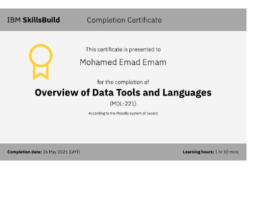</a> 
      <strong>Overview Of Data Tools And Languages</strong> 
      IBM SkillsBuild · Year not listed 
      <a href="https://raw.githubusercontent.com/EMAD7461/EMAD7461/main/certificates/previews/data-analytics/overview-of-data-tools-and-languages.jpg">View image preview ↗</a> · <a href="https://github.com/EMAD7461/EMAD7461/blob/main/certificates/data-analytics/overview-of-data-tools-and-languages.pdf">Open original PDF ↗</a>
    </td>
    <td width="50%" align="center" valign="top">
       
      <strong>Data Analysis in Excel</strong> 
      DataCamp · 2026 
      <a href="https://raw.githubusercontent.com/EMAD7461/EMAD7461/main/certificates/previews/data-analytics/data-analysis-in-excel.jpg">View image preview ↗</a> · <a href="https://github.com/EMAD7461/EMAD7461/blob/main/certificates/data-analytics/data-analysis-in-excel.pdf">Open original PDF ↗</a>
    </td>
  </tr>
  <tr>
    <td width="50%" align="center" valign="top">
       
      <strong>Introduction to DAX in Power BI</strong> 
      DataCamp · Year not listed 
      <a href="https://raw.githubusercontent.com/EMAD7461/EMAD7461/main/certificates/previews/data-analytics/introduction-to-dax-in-power-bi.jpg">View image preview ↗</a> · <a href="https://github.com/EMAD7461/EMAD7461/blob/main/certificates/data-analytics/introduction-to-dax-in-power-bi.pdf">Open original PDF ↗</a>
    </td>
    <td width="50%"></td>
  </tr>
</tbody></table>

[↑ Back to areas](#explore-by-area)

---

## Artificial Intelligence and Machine Learning

<table><tbody>
  <tr>
    <td width="50%" align="center" valign="top">
      <a href="https://raw.githubusercontent.com/EMAD7461/EMAD7461/main/certificates/previews/ai-and-machine-learning/ai-literacy.jpg">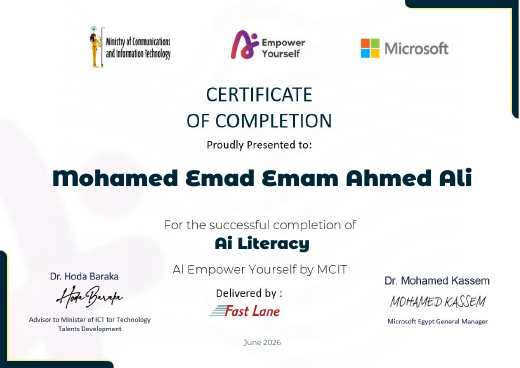</a> 
      <strong>AI Literacy</strong> 
      Egyptian Ministry of Communications (MCIT) · Fast Lane · 2026 
      <a href="https://raw.githubusercontent.com/EMAD7461/EMAD7461/main/certificates/previews/ai-and-machine-learning/ai-literacy.jpg">View image preview ↗</a> · <a href="https://github.com/EMAD7461/EMAD7461/blob/main/certificates/ai-and-machine-learning/ai-literacy.pdf">Open original PDF ↗</a>
    </td>
    <td width="50%" align="center" valign="top">
      <a href="https://github.com/EMAD7461/EMAD7461/blob/main/certificates/ai-and-machine-learning/elements-of-ai-for-business.png">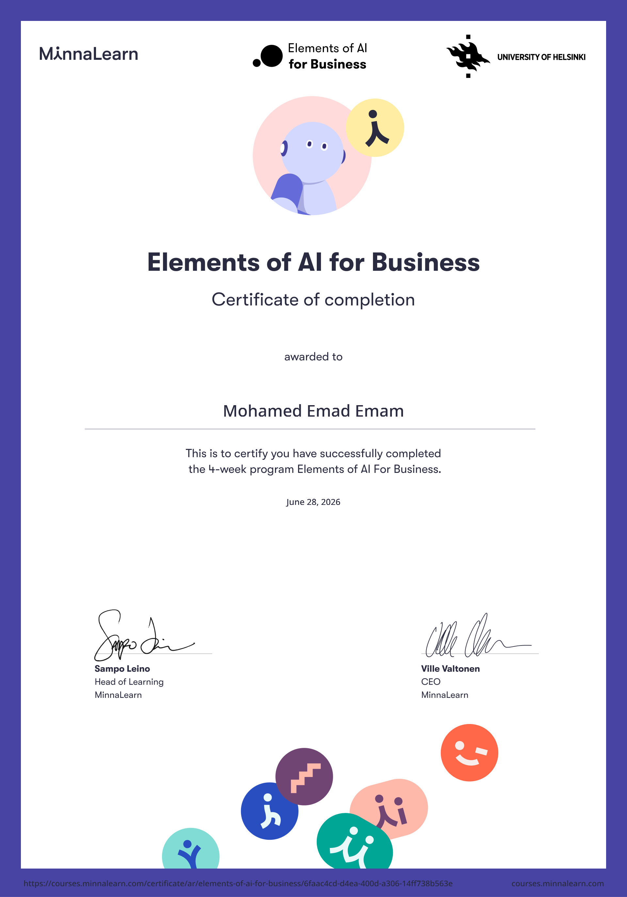</a> 
      <strong>Elements of AI for Business</strong> 
      Elements of AI · Year not listed 
      <a href="https://github.com/EMAD7461/EMAD7461/blob/main/certificates/ai-and-machine-learning/elements-of-ai-for-business.png">Open original PNG ↗</a>
    </td>
  </tr>
  <tr>
    <td width="50%" align="center" valign="top">
      <a href="https://github.com/EMAD7461/EMAD7461/blob/main/certificates/ai-and-machine-learning/general-ai-literacy-get-ai-ready-2025-edition.png">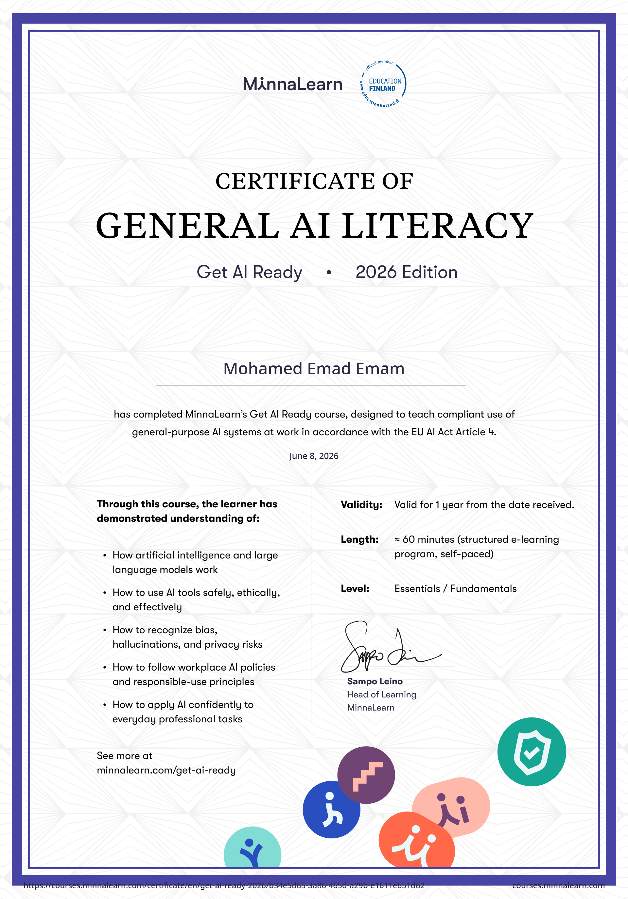</a> 
      <strong>General AI Literacy: Get AI Ready (2025 Edition)</strong> 
      MinnaLearn · University of Helsinki · 2025 
      <a href="https://github.com/EMAD7461/EMAD7461/blob/main/certificates/ai-and-machine-learning/general-ai-literacy-get-ai-ready-2025-edition.png">Open original PNG ↗</a>
    </td>
    <td width="50%" align="center" valign="top">
      <a href="https://raw.githubusercontent.com/EMAD7461/EMAD7461/main/certificates/previews/ai-and-machine-learning/ai-literacy-and-data-literacy.jpg">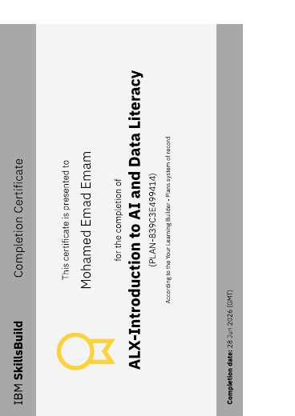</a> 
      <strong>AI Literacy and Data Literacy</strong> 
      IBM SkillsBuild · Year not listed 
      <a href="https://raw.githubusercontent.com/EMAD7461/EMAD7461/main/certificates/previews/ai-and-machine-learning/ai-literacy-and-data-literacy.jpg">View image preview ↗</a> · <a href="https://github.com/EMAD7461/EMAD7461/blob/main/certificates/ai-and-machine-learning/ai-literacy-and-data-literacy.pdf">Open original PDF ↗</a>
    </td>
  </tr>
  <tr>
    <td width="50%" align="center" valign="top">
      <a href="https://raw.githubusercontent.com/EMAD7461/EMAD7461/main/certificates/previews/ai-and-machine-learning/aws-ai-practitioner-challenge.jpg">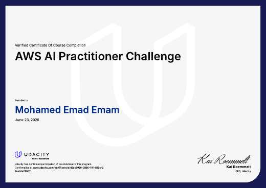</a> 
      <strong>AWS AI Practitioner Challenge</strong> 
      Udacity · 2025 
      <a href="https://raw.githubusercontent.com/EMAD7461/EMAD7461/main/certificates/previews/ai-and-machine-learning/aws-ai-practitioner-challenge.jpg">View image preview ↗</a> · <a href="https://github.com/EMAD7461/EMAD7461/blob/main/certificates/ai-and-machine-learning/aws-ai-practitioner-challenge.pdf">Open original PDF ↗</a>
    </td>
    <td width="50%" align="center" valign="top">
       
      <strong>Career Ready AI and Professional Skills</strong> 
      INCO Academy · MetLife Foundation · 2026 
      <a href="https://raw.githubusercontent.com/EMAD7461/EMAD7461/main/certificates/previews/ai-and-machine-learning/career-ready-ai-and-professional-skills.jpg">View image preview ↗</a> · <a href="https://github.com/EMAD7461/EMAD7461/blob/main/certificates/ai-and-machine-learning/career-ready-ai-and-professional-skills.pdf">Open original PDF ↗</a>
    </td>
  </tr>
  <tr>
    <td width="50%" align="center" valign="top">
       
      <strong>1 Million Prompters — AI Prompt Engineering</strong> 
      Dubai Future Foundation · Dubai Centre for Artificial Intelligence · Year not listed 
      <a href="https://raw.githubusercontent.com/EMAD7461/EMAD7461/main/certificates/previews/ai-and-machine-learning/1-million-prompters-ai-prompt-engineering-arabic.jpg">View image preview ↗</a> · <a href="https://github.com/EMAD7461/EMAD7461/blob/main/certificates/ai-and-machine-learning/1-million-prompters-ai-prompt-engineering-arabic.pdf">Open original PDF ↗</a>
    </td>
    <td width="50%" align="center" valign="top">
       
      <strong>1 Million Prompters — AI Prompt Engineering</strong> 
      Dubai Future Foundation · Dubai Centre for Artificial Intelligence · Year not listed 
      <a href="https://raw.githubusercontent.com/EMAD7461/EMAD7461/main/certificates/previews/ai-and-machine-learning/1-million-prompters-ai-prompt-engineering-english.jpg">View image preview ↗</a> · <a href="https://github.com/EMAD7461/EMAD7461/blob/main/certificates/ai-and-machine-learning/1-million-prompters-ai-prompt-engineering-english.pdf">Open original PDF ↗</a>
    </td>
  </tr>
  <tr>
    <td width="50%" align="center" valign="top">
       
      <strong>AI and Machine Learning</strong> 
      Sprints · Year not listed 
      <a href="https://raw.githubusercontent.com/EMAD7461/EMAD7461/main/certificates/previews/ai-and-machine-learning/ai-and-machine-learning.jpg">View image preview ↗</a> · <a href="https://github.com/EMAD7461/EMAD7461/blob/main/certificates/ai-and-machine-learning/ai-and-machine-learning.pdf">Open original PDF ↗</a>
    </td>
    <td width="50%" align="center" valign="top">
      <a href="https://github.com/EMAD7461/EMAD7461/blob/main/certificates/ai-and-machine-learning/generative-ai-overview-for-project-managers.png">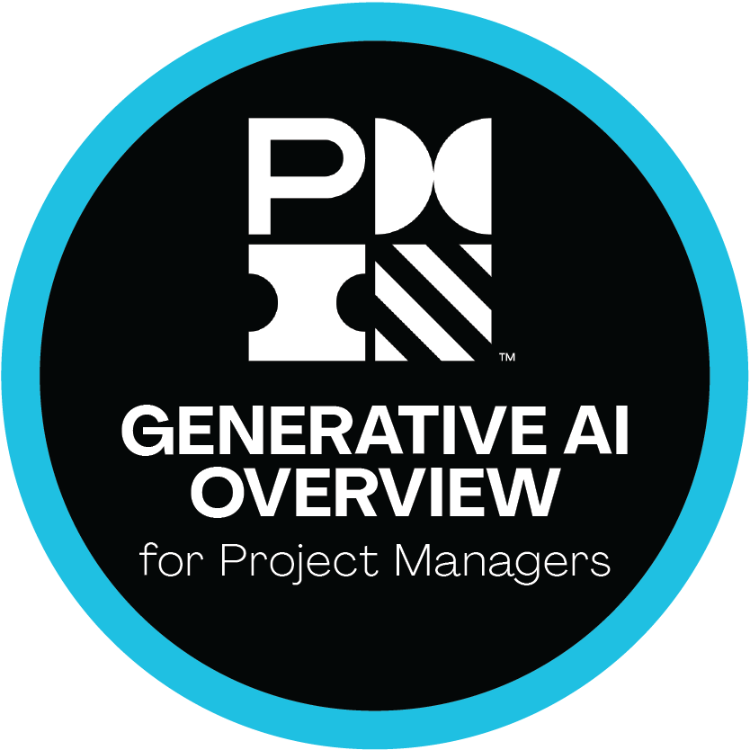</a> 
      <strong>Generative AI Overview for Project Managers</strong> 
      Project Management Institute (PMI) · Year not listed 
      <a href="https://github.com/EMAD7461/EMAD7461/blob/main/certificates/ai-and-machine-learning/generative-ai-overview-for-project-managers.png">Open original PNG ↗</a>
    </td>
  </tr>
  <tr>
    <td width="50%" align="center" valign="top">
      <a href="https://raw.githubusercontent.com/EMAD7461/EMAD7461/main/certificates/previews/ai-and-machine-learning/ai-ethics.jpg">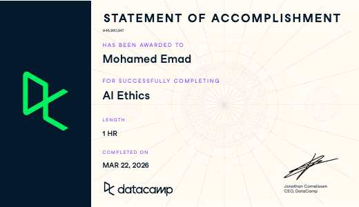</a> 
      <strong>AI Ethics</strong> 
      DataCamp · 2026 
      <a href="https://raw.githubusercontent.com/EMAD7461/EMAD7461/main/certificates/previews/ai-and-machine-learning/ai-ethics.jpg">View image preview ↗</a> · <a href="https://github.com/EMAD7461/EMAD7461/blob/main/certificates/ai-and-machine-learning/ai-ethics.pdf">Open original PDF ↗</a>
    </td>
    <td width="50%"></td>
  </tr>
</tbody></table>

[↑ Back to areas](#explore-by-area)

---

## Business and Career Development

<table><tbody>
  <tr>
    <td width="50%" align="center" valign="top">
      <a href="https://raw.githubusercontent.com/EMAD7461/EMAD7461/main/certificates/previews/business-and-career-development/financial-modeling-bootcamp.jpg">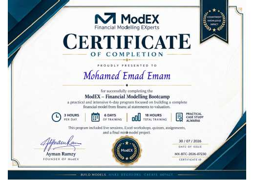</a> 
      <strong>Financial Modeling Bootcamp</strong> 
      ModEx · 2025 
      <a href="https://raw.githubusercontent.com/EMAD7461/EMAD7461/main/certificates/previews/business-and-career-development/financial-modeling-bootcamp.jpg">View image preview ↗</a> · <a href="https://github.com/EMAD7461/EMAD7461/blob/main/certificates/business-and-career-development/financial-modeling-bootcamp.pdf">Open original PDF ↗</a>
    </td>
    <td width="50%" align="center" valign="top">
      <a href="https://raw.githubusercontent.com/EMAD7461/EMAD7461/main/certificates/previews/business-and-career-development/digital-entrepreneurship-program.jpg">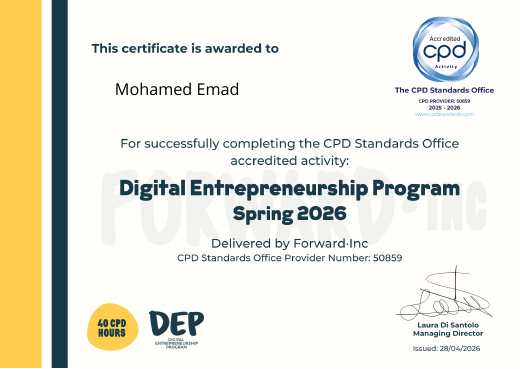</a> 
      <strong>Digital Entrepreneurship Program</strong> 
      CPO Standards Office · 2026 
      <a href="https://raw.githubusercontent.com/EMAD7461/EMAD7461/main/certificates/previews/business-and-career-development/digital-entrepreneurship-program.jpg">View image preview ↗</a> · <a href="https://github.com/EMAD7461/EMAD7461/blob/main/certificates/business-and-career-development/digital-entrepreneurship-program.pdf">Open original PDF ↗</a>
    </td>
  </tr>
  <tr>
    <td width="50%" align="center" valign="top">
      <a href="https://github.com/EMAD7461/EMAD7461/blob/main/certificates/business-and-career-development/odoo-functional-business-course.png">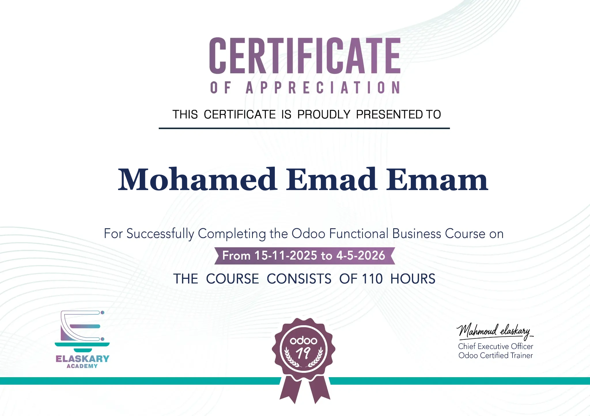</a> 
      <strong>Odoo Functional Business Course</strong> 
      Al Eskary · 2026 
      <a href="https://github.com/EMAD7461/EMAD7461/blob/main/certificates/business-and-career-development/odoo-functional-business-course.png">Open original PNG ↗</a>
    </td>
    <td width="50%" align="center" valign="top">
      <a href="https://raw.githubusercontent.com/EMAD7461/EMAD7461/main/certificates/previews/business-and-career-development/accelerate-your-job-search-with-ai.jpg">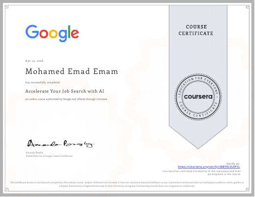</a> 
      <strong>Accelerate Your Job Search with AI</strong> 
      Google / Coursera · 2026 
      <a href="https://raw.githubusercontent.com/EMAD7461/EMAD7461/main/certificates/previews/business-and-career-development/accelerate-your-job-search-with-ai.jpg">View image preview ↗</a> · <a href="https://github.com/EMAD7461/EMAD7461/blob/main/certificates/business-and-career-development/accelerate-your-job-search-with-ai.pdf">Open original PDF ↗</a>
    </td>
  </tr>
  <tr>
    <td width="50%" align="center" valign="top">
      <a href="https://raw.githubusercontent.com/EMAD7461/EMAD7461/main/certificates/previews/business-and-career-development/mckinsey-org-forward-program.jpg">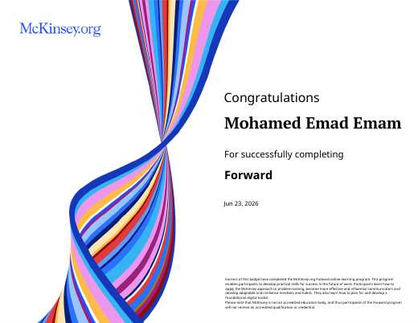</a> 
      <strong>McKinsey.org Forward Program</strong> 
      McKinsey.org · 2026 
      <a href="https://raw.githubusercontent.com/EMAD7461/EMAD7461/main/certificates/previews/business-and-career-development/mckinsey-org-forward-program.jpg">View image preview ↗</a> · <a href="https://github.com/EMAD7461/EMAD7461/blob/main/certificates/business-and-career-development/mckinsey-org-forward-program.pdf">Open original PDF ↗</a>
    </td>
    <td width="50%" align="center" valign="top">
      <a href="https://raw.githubusercontent.com/EMAD7461/EMAD7461/main/certificates/previews/business-and-career-development/financial-modeling-bootcamp-credential-copy.jpg">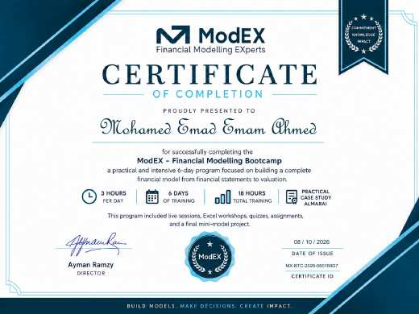</a> 
      <strong>Financial Modeling Bootcamp (Credential Copy)</strong> 
      ModEx · 2026 
      <a href="https://raw.githubusercontent.com/EMAD7461/EMAD7461/main/certificates/previews/business-and-career-development/financial-modeling-bootcamp-credential-copy.jpg">View image preview ↗</a> · <a href="https://github.com/EMAD7461/EMAD7461/blob/main/certificates/business-and-career-development/financial-modeling-bootcamp-credential-copy.pdf">Open original PDF ↗</a>
    </td>
  </tr>
  <tr>
    <td width="50%" align="center" valign="top">
      <a href="https://raw.githubusercontent.com/EMAD7461/EMAD7461/main/certificates/previews/business-and-career-development/your-future-in-data-the-job-landscape.jpg">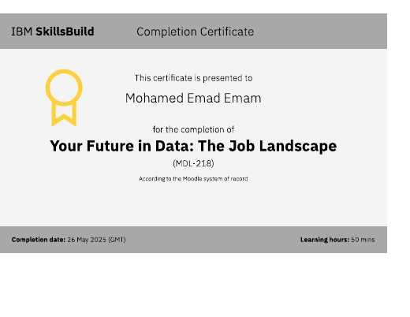</a> 
      <strong>Your Future in Data: The Job Landscape</strong> 
      IBM SkillsBuild · Year not listed 
      <a href="https://raw.githubusercontent.com/EMAD7461/EMAD7461/main/certificates/previews/business-and-career-development/your-future-in-data-the-job-landscape.jpg">View image preview ↗</a> · <a href="https://github.com/EMAD7461/EMAD7461/blob/main/certificates/business-and-career-development/your-future-in-data-the-job-landscape.pdf">Open original PDF ↗</a>
    </td>
    <td width="50%" align="center" valign="top">
      <a href="https://raw.githubusercontent.com/EMAD7461/EMAD7461/main/certificates/previews/business-and-career-development/innovegypt-program-certificate.jpg">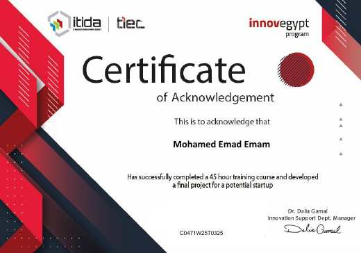</a> 
      <strong>InnovEgypt Program Certificate</strong> 
      InnovEgypt · 2025 
      <a href="https://raw.githubusercontent.com/EMAD7461/EMAD7461/main/certificates/previews/business-and-career-development/innovegypt-program-certificate.jpg">View image preview ↗</a> · <a href="https://github.com/EMAD7461/EMAD7461/blob/main/certificates/business-and-career-development/innovegypt-program-certificate.pdf">Open original PDF ↗</a>
    </td>
  </tr>
  <tr>
    <td width="50%" align="center" valign="top">
       
      <strong>Bank Misr Training Certificate</strong> 
      Mahara Tech · Year not listed 
      <a href="https://raw.githubusercontent.com/EMAD7461/EMAD7461/main/certificates/previews/business-and-career-development/bank-misr-training-certificate.jpg">View image preview ↗</a> · <a href="https://github.com/EMAD7461/EMAD7461/blob/main/certificates/business-and-career-development/bank-misr-training-certificate.pdf">Open original PDF ↗</a>
    </td>
    <td width="50%"></td>
  </tr>
</tbody></table>

[↑ Back to areas](#explore-by-area)

---

## Cloud and Digital Foundations

<table><tbody>
  <tr>
    <td width="50%" align="center" valign="top">
      <a href="https://raw.githubusercontent.com/EMAD7461/EMAD7461/main/certificates/previews/cloud-and-digital-foundations/understanding-cloud-computing.jpg">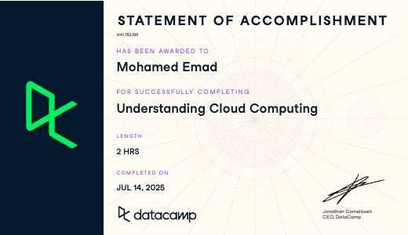</a> 
      <strong>Understanding Cloud Computing</strong> 
      DataCamp · 2025 
      <a href="https://raw.githubusercontent.com/EMAD7461/EMAD7461/main/certificates/previews/cloud-and-digital-foundations/understanding-cloud-computing.jpg">View image preview ↗</a> · <a href="https://github.com/EMAD7461/EMAD7461/blob/main/certificates/cloud-and-digital-foundations/understanding-cloud-computing.pdf">Open original PDF ↗</a>
    </td>
    <td width="50%" align="center" valign="top">
      <a href="https://raw.githubusercontent.com/EMAD7461/EMAD7461/main/certificates/previews/cloud-and-digital-foundations/understanding-cloud-computing-services.jpg">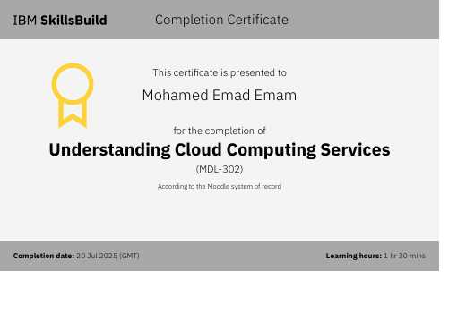</a> 
      <strong>Understanding Cloud Computing Services</strong> 
      IBM SkillsBuild · Year not listed 
      <a href="https://raw.githubusercontent.com/EMAD7461/EMAD7461/main/certificates/previews/cloud-and-digital-foundations/understanding-cloud-computing-services.jpg">View image preview ↗</a> · <a href="https://github.com/EMAD7461/EMAD7461/blob/main/certificates/cloud-and-digital-foundations/understanding-cloud-computing-services.pdf">Open original PDF ↗</a>
    </td>
  </tr>
  <tr>
    <td width="50%" align="center" valign="top">
      <a href="https://raw.githubusercontent.com/EMAD7461/EMAD7461/main/certificates/previews/cloud-and-digital-foundations/understanding-cloud-deployment-models.jpg">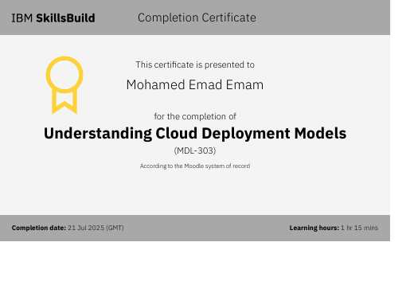</a> 
      <strong>Understanding Cloud Deployment Models</strong> 
      IBM SkillsBuild · Year not listed 
      <a href="https://raw.githubusercontent.com/EMAD7461/EMAD7461/main/certificates/previews/cloud-and-digital-foundations/understanding-cloud-deployment-models.jpg">View image preview ↗</a> · <a href="https://github.com/EMAD7461/EMAD7461/blob/main/certificates/cloud-and-digital-foundations/understanding-cloud-deployment-models.pdf">Open original PDF ↗</a>
    </td>
    <td width="50%"></td>
  </tr>
</tbody></table>

[↑ Back to areas](#explore-by-area)

---

## Cybersecurity and AI Governance

<table><tbody>
  <tr>
    <td width="50%" align="center" valign="top">
       
      <strong>Cybersecurity for All</strong> 
      Mahara Tech · Year not listed 
      <a href="https://raw.githubusercontent.com/EMAD7461/EMAD7461/main/certificates/previews/cybersecurity-and-ai-governance/cybersecurity-for-all.jpg">View image preview ↗</a> · <a href="https://github.com/EMAD7461/EMAD7461/blob/main/certificates/cybersecurity-and-ai-governance/cybersecurity-for-all.pdf">Open original PDF ↗</a>
    </td>
    <td width="50%" align="center" valign="top">
      <a href="https://raw.githubusercontent.com/EMAD7461/EMAD7461/main/certificates/previews/cybersecurity-and-ai-governance/ai-security-governance-certification.jpg">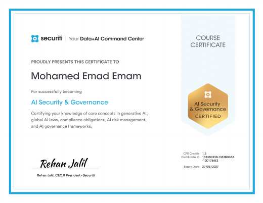</a> 
      <strong>AI Security &amp; Governance Certification</strong> 
      Securiti Education · Year not listed 
      <a href="https://raw.githubusercontent.com/EMAD7461/EMAD7461/main/certificates/previews/cybersecurity-and-ai-governance/ai-security-governance-certification.jpg">View image preview ↗</a> · <a href="https://github.com/EMAD7461/EMAD7461/blob/main/certificates/cybersecurity-and-ai-governance/ai-security-governance-certification.pdf">Open original PDF ↗</a>
    </td>
  </tr>
  <tr>
    <td width="50%" align="center" valign="top">
      <a href="https://raw.githubusercontent.com/EMAD7461/EMAD7461/main/certificates/previews/cybersecurity-and-ai-governance/data-security-posture-management-dspm-fundamentals.jpg">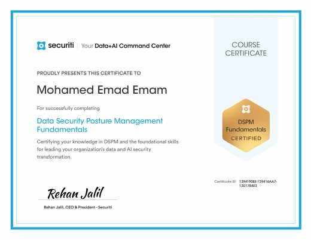</a> 
      <strong>Data Security Posture Management (DSPM) Fundamentals</strong> 
      Securiti Education · Year not listed 
      <a href="https://raw.githubusercontent.com/EMAD7461/EMAD7461/main/certificates/previews/cybersecurity-and-ai-governance/data-security-posture-management-dspm-fundamentals.jpg">View image preview ↗</a> · <a href="https://github.com/EMAD7461/EMAD7461/blob/main/certificates/cybersecurity-and-ai-governance/data-security-posture-management-dspm-fundamentals.pdf">Open original PDF ↗</a>
    </td>
    <td width="50%" align="center" valign="top">
       
      <strong>Ai Governance Program Mgmt</strong> 
      Securiti Education · Year not listed 
      <a href="https://github.com/EMAD7461/EMAD7461/blob/main/certificates/cybersecurity-and-ai-governance/ai-governance-program-mgmt.png">Open original PNG ↗</a>
    </td>
  </tr>
  <tr>
    <td width="50%" align="center" valign="top">
       
      <strong>Ai Regulatory Compliance</strong> 
      Securiti Education · Year not listed 
      <a href="https://github.com/EMAD7461/EMAD7461/blob/main/certificates/cybersecurity-and-ai-governance/ai-regulatory-compliance.png">Open original PNG ↗</a>
    </td>
    <td width="50%" align="center" valign="top">
       
      <strong>Ai Risk Assessment</strong> 
      Securiti Education · Year not listed 
      <a href="https://github.com/EMAD7461/EMAD7461/blob/main/certificates/cybersecurity-and-ai-governance/ai-risk-assessment.png">Open original PNG ↗</a>
    </td>
  </tr>
  <tr>
    <td width="50%" align="center" valign="top">
      <a href="https://github.com/EMAD7461/EMAD7461/blob/main/certificates/cybersecurity-and-ai-governance/controlling-data-io.png">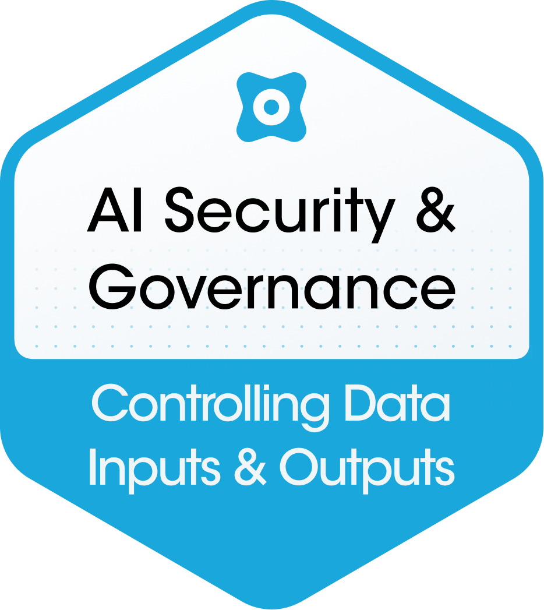</a> 
      <strong>Controlling Data Io</strong> 
      Securiti Education · Year not listed 
      <a href="https://github.com/EMAD7461/EMAD7461/blob/main/certificates/cybersecurity-and-ai-governance/controlling-data-io.png">Open original PNG ↗</a>
    </td>
    <td width="50%" align="center" valign="top">
       
      <strong>Intro Ai Model Discovery</strong> 
      Securiti Education · Year not listed 
      <a href="https://github.com/EMAD7461/EMAD7461/blob/main/certificates/cybersecurity-and-ai-governance/intro-ai-model-discovery.png">Open original PNG ↗</a>
    </td>
  </tr>
  <tr>
    <td width="50%" align="center" valign="top">
       
      <strong>Intro To Ai Governance</strong> 
      Securiti Education · Year not listed 
      <a href="https://github.com/EMAD7461/EMAD7461/blob/main/certificates/cybersecurity-and-ai-governance/intro-to-ai-governance.png">Open original PNG ↗</a>
    </td>
    <td width="50%" align="center" valign="top">
       
      <strong>Intro To Gen Ai</strong> 
      Securiti Education · Year not listed 
      <a href="https://github.com/EMAD7461/EMAD7461/blob/main/certificates/cybersecurity-and-ai-governance/intro-to-gen-ai.png">Open original PNG ↗</a>
    </td>
  </tr>
  <tr>
    <td width="50%" align="center" valign="top">
       
      <strong>Understanding Data Ai Relationships</strong> 
      Securiti Education · Year not listed 
      <a href="https://github.com/EMAD7461/EMAD7461/blob/main/certificates/cybersecurity-and-ai-governance/understanding-data-ai-relationships.png">Open original PNG ↗</a>
    </td>
    <td width="50%"></td>
  </tr>
</tbody></table>

[↑ Back to areas](#explore-by-area)

---

## Product Design and Marketing

<table><tbody>
  <tr>
    <td width="50%" align="center" valign="top">
       
      <strong>Digital Marketing</strong> 
      Sprints · Year not listed 
      <a href="https://raw.githubusercontent.com/EMAD7461/EMAD7461/main/certificates/previews/product-design-and-marketing/digital-marketing.jpg">View image preview ↗</a> · <a href="https://github.com/EMAD7461/EMAD7461/blob/main/certificates/product-design-and-marketing/digital-marketing.pdf">Open original PDF ↗</a>
    </td>
    <td width="50%" align="center" valign="top">
       
      <strong>Product Management</strong> 
      Sprints · Year not listed 
      <a href="https://raw.githubusercontent.com/EMAD7461/EMAD7461/main/certificates/previews/product-design-and-marketing/product-management.jpg">View image preview ↗</a> · <a href="https://github.com/EMAD7461/EMAD7461/blob/main/certificates/product-design-and-marketing/product-management.pdf">Open original PDF ↗</a>
    </td>
  </tr>
  <tr>
    <td width="50%" align="center" valign="top">
       
      <strong>UI/UX Design</strong> 
      Sprints · Year not listed 
      <a href="https://raw.githubusercontent.com/EMAD7461/EMAD7461/main/certificates/previews/product-design-and-marketing/ui-ux-design.jpg">View image preview ↗</a> · <a href="https://github.com/EMAD7461/EMAD7461/blob/main/certificates/product-design-and-marketing/ui-ux-design.pdf">Open original PDF ↗</a>
    </td>
    <td width="50%"></td>
  </tr>
</tbody></table>

[↑ Back to areas](#explore-by-area)

---

## Software Development

<table><tbody>
  <tr>
    <td width="50%" align="center" valign="top">
      <a href="https://raw.githubusercontent.com/EMAD7461/EMAD7461/main/certificates/previews/software-development/programming-with-python.jpg">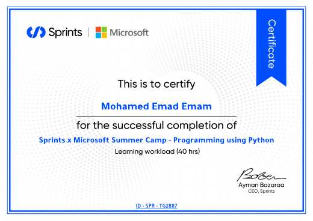</a> 
      <strong>Programming with Python</strong> 
      Sprints · Year not listed 
      <a href="https://raw.githubusercontent.com/EMAD7461/EMAD7461/main/certificates/previews/software-development/programming-with-python.jpg">View image preview ↗</a> · <a href="https://github.com/EMAD7461/EMAD7461/blob/main/certificates/software-development/programming-with-python.pdf">Open original PDF ↗</a>
    </td>
    <td width="50%" align="center" valign="top">
       
      <strong>Web Development</strong> 
      Sprints · Year not listed 
      <a href="https://raw.githubusercontent.com/EMAD7461/EMAD7461/main/certificates/previews/software-development/web-development.jpg">View image preview ↗</a> · <a href="https://github.com/EMAD7461/EMAD7461/blob/main/certificates/software-development/web-development.pdf">Open original PDF ↗</a>
    </td>
  </tr>
</tbody></table>

[↑ Back to areas](#explore-by-area)

---

## Additional Credentials

<table><tbody>
  <tr>
    <td width="50%" align="center" valign="top">
      <a href="https://raw.githubusercontent.com/EMAD7461/EMAD7461/main/certificates/previews/other-credentials/20-hour-course-completion-certificate.jpg">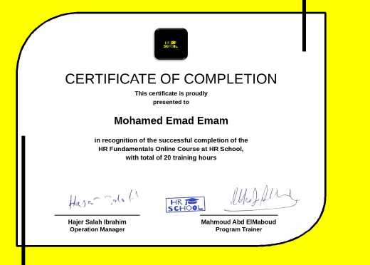</a> 
      <strong>20-Hour Course Completion Certificate</strong> 
      Issuer details not legible · Year not listed 
      <a href="https://raw.githubusercontent.com/EMAD7461/EMAD7461/main/certificates/previews/other-credentials/20-hour-course-completion-certificate.jpg">View image preview ↗</a> · <a href="https://github.com/EMAD7461/EMAD7461/blob/main/certificates/other-credentials/20-hour-course-completion-certificate.pdf">Open original PDF ↗</a>
    </td>
    <td width="50%"></td>
  </tr>
</tbody></table>

[↑ Back to areas](#explore-by-area)

---

Original certificates remain in their organized folders. Previews are provided to make the collection easy to scan on GitHub.

